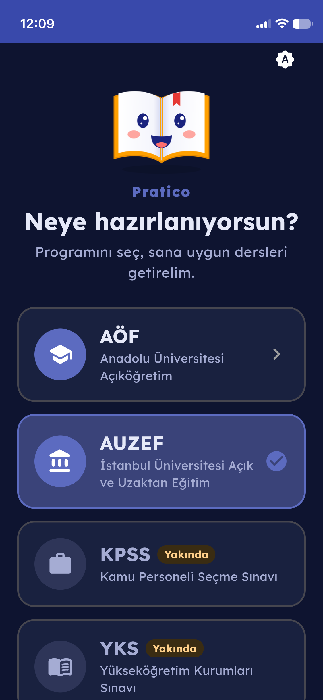
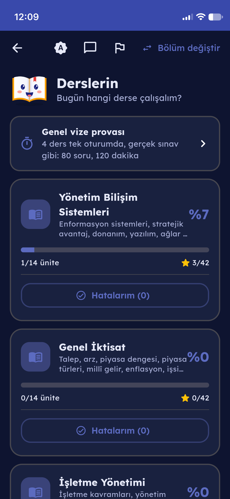
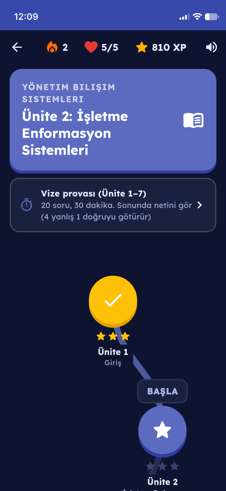
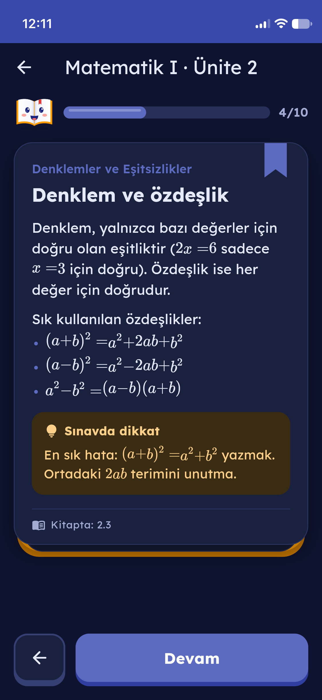
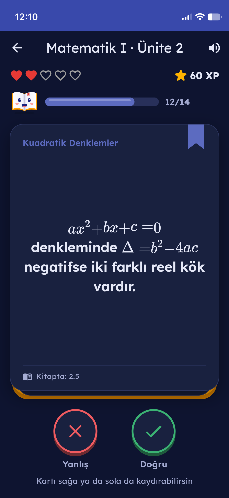

# Pratico

**Açıköğretim sınavlarına oyun gibi hazırlan.**
Kısa konu anlatımları, ünite ünite ilerleyen bir harita ve gerçek sınav formatında provalarla günde birkaç dakikada çalış.

🔗 **Dene:** [getpratico.web.app](https://getpratico.web.app)
Kurulum gerektirmez. Telefonda tarayıcıdan aç, "Ana Ekrana Ekle" ile uygulama gibi kullan.

  
  
  

  
  

## Özellikler

- **Ünite haritası:** Her ders, kilidi açılarak ilerlenen bir yol. Her ünite için 3 yıldız.
- **Konu anlatımı kartları:** Her ünite kısa kartlara bölünmüş; örnekler ve "Sınavda dikkat" notlarıyla.
- **Farklı soru tipleri:** Doğru/yanlış kaydırma, boşluk doldurma, çoktan seçmeli.
- **Can, seri ve XP:** Yanlış cevap can götürür; doğru cevap serileri ödüllendirilir.
- **Hatalarım:** Yanlış yapılan sorular ayrı bir tekrar destesinde toplanır.
- **Vize provası:** Gerçek sınav formatında; süreli, boş bırakılabilir, sonuç *4 yanlış 1 doğruyu götürür* kuralıyla net olarak.
- **Genel vize provası:** Dönemin tüm dersleri tek oturumda (80 soru, 120 dakika); ders bazında net.
- **Formül desteği:** Matematik soruları ve anlatımları gerçek matematik yazımıyla.
- **Karanlık mod:** Cihaz ayarını takip eder, uygulama içinden de değiştirilebilir.
- **Geri bildirim:** Hatalı soru tek dokunuşla bildirilir; mesajlar doğrudan geliştiriciye ulaşır.

## İçerik

Şu an **İstanbul Üniversitesi AUZEF Yönetim Bilişim Sistemleri** 1. sınıf dersleri:

| Ders | Ünite |
|---|---|
| Yönetim Bilişim Sistemleri | 14 |
| Genel İktisat | 14 |
| İşletme Yönetimi | 8 |
| Matematik I | 8 |

Toplam 1.100'den fazla soru ve vize konuları için 135 konu anlatımı kartı. Sorular ders kitaplarına göre özgün olarak yazılmıştır; her sorunun altında kitaptaki bölüm numarası yer alır.

## Teknoloji

- **Flutter / Dart** (Material 3), web için **WebAssembly** derlemesi
- **Firebase Hosting** (yayın) ve **Cloud Firestore** (geri bildirimler)
- Web Audio API ile hafif ses efektleri, KaTeX tabanlı formül yazımı
- 75'ten fazla otomatik test (birim ve arayüz testleri)

## Yol haritası

- Final ünitelerinin konu anlatımları
- Hesap ve cihazlar arası senkronizasyon
- Google Play ve App Store sürümleri
- Yeni bölümler

---

Pratico bağımsız bir projedir; İstanbul Üniversitesi, AUZEF veya Anadolu Üniversitesi ile resmî bir bağlantısı yoktur.

Kaynak kodu gizlidir. Geri bildirim için uygulama içindeki **Geri bildirim gönder** düğmesini kullanabilirsiniz.

© 2026 Ali Yavuz
